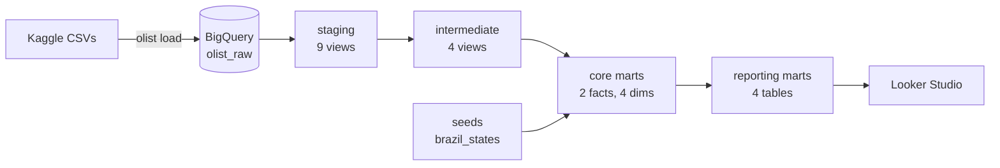

# E-commerce Analytics Pipeline: Olist

[](https://github.com/<your-username>/ecommerce-analytics-dbt/actions/workflows/ci.yml)
[](https://<your-username>.github.io/ecommerce-analytics-dbt/)


An ELT pipeline and dimensional model for ~100k orders from Olist, a Brazilian marketplace.
Raw CSVs land in BigQuery, dbt turns them into a tested star schema, and a Looker Studio
dashboard answers four business questions.

**[View the dashboard](<looker-studio-link>)** · **[Browse the dbt docs and lineage](https://<your-username>.github.io/ecommerce-analytics-dbt/)**


## Key findings

| Question | Finding |
|---|---|
| Does late delivery hurt reviews? | [e.g. Orders delivered 8+ days late average X stars vs Y for on-time orders; their 1-star rate is Z× higher.] |
| How is the business trending? | [e.g. Monthly revenue grew X% from Jan 2017 to Aug 2018; November 2017 (Black Friday) was the peak.] |
| How concentrated are sellers? | [e.g. The top 10% of sellers earn X% of revenue.] |
| Do customers come back? | [e.g. Only X% of customers ever place a second order.] |

## Architecture



| Layer | What it does |
|---|---|
| **Raw** | CSVs loaded unchanged, every column as text, by a small Python loader. |
| **Staging** | One view per source: rename, cast, fix source typos, normalise zip codes and city names. |
| **Intermediate** | Deduplicate reviews, roll payments and items up to order grain, clean geolocation. |
| **Core marts** | Star schema: `fct_orders`, `fct_order_items`, `dim_customers`, `dim_sellers`, `dim_products`, `dim_dates`. |
| **Reporting marts** | One dashboard-ready table per business question. |

## Data quality and testing

- **90+ dbt data tests**: primary keys, relationships between every fact and dimension,
  accepted values, value ranges, and a revenue reconciliation between the fact and
  reporting layers.
- **Unit tests** for the two pieces of logic most likely to be gotten wrong: review
  deduplication and the late-delivery rules.
- **A custom generic test** (`not_before`) for timestamp ordering.
- **Severity by ownership**: checks on source data we don't control *warn*; checks on our
  own logic *fail the build*.
- **CI on every push**: builds the whole project against synthetic data with the same
  quirks as the real files, then runs SQLFluff, Ruff and pytest.

Data issues found and handled:

- Olist issues a new `customer_id` for every order, so customers are modelled on `customer_unique_id`.
- Some orders have several reviews and some review ids span several orders; the latest review per order is kept.
- Zip prefixes lose leading zeros; the geolocation file has many points per zip and some outside Brazil.
- Two product categories have no English translation; they fall back to the Portuguese name.
- Data before 2017 and after August 2018 is incomplete, so reporting covers January 2017 to August 2018.

## Project structure

```
├── src/olist_loader/      # Python: load CSVs into BigQuery or DuckDB, generate sample data
├── models/
│   ├── staging/olist/     # stg_olist__*: one per source table
│   ├── intermediate/      # int_*: reusable reshaping
│   └── marts/
│       ├── core/          # fct_* and dim_*
│       └── reporting/     # rpt_*: dashboard tables, plus the dashboard exposure
├── seeds/                 # brazil_states.csv
├── macros/                # cross-warehouse helpers
├── analyses/              # ad-hoc SQL behind the key findings
├── tests/dbt/             # singular and custom generic dbt tests
├── tests/python/          # pytest for the loader
└── .github/workflows/     # CI and docs publishing
```

## Run it yourself

Requires Python 3.11+.

```bash
git clone https://github.com/<your-username>/ecommerce-analytics-dbt.git
cd ecommerce-analytics-dbt
python -m venv .venv && source .venv/bin/activate
make install
```

**Try it locally in two minutes (no cloud account, synthetic data):**

```bash
make sample   # generate sample data and load it into DuckDB
make build    # build and test every model
```

**Run on the real data in BigQuery:**

1. Download the [Olist dataset](https://www.kaggle.com/datasets/olistbr/brazilian-ecommerce) and unzip the CSVs into `data/raw/`.
2. Create a free [BigQuery sandbox](https://console.cloud.google.com/bigquery) project and log in: `gcloud auth application-default login`.
3. Then:

```bash
export GCP_PROJECT=your-project-id
make load-bq    # land the CSVs in the olist_raw dataset
make build-bq   # build and test all models in BigQuery
```

## Tech

Python · dbt Core · BigQuery · DuckDB · SQL · Looker Studio · SQLFluff · pytest · GitHub Actions

Data: [Olist Brazilian E-Commerce Public Dataset](https://www.kaggle.com/datasets/olistbr/brazilian-ecommerce), CC BY-NC-SA 4.0.
